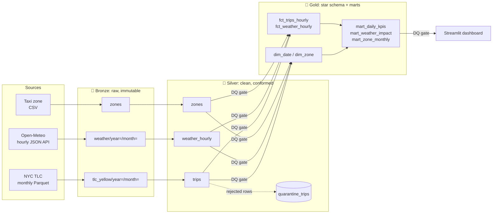

# NYC Mobility Lakehouse

A **medallion (Bronze → Silver → Gold) lakehouse** that ingests real NYC taxi trips and hourly
weather, cleans and validates them with quality gates between layers, and publishes a star schema plus
analytics marts that answer one question: **how does weather change taxi demand and revenue in New York?**

Everything here is **free and open source**. There are no API keys, no cloud accounts and no paid services.

| | |
|---|---|
| **Scale** | 9.5M raw trips (Q1 2024) → 9.2M clean trips, processed end-to-end in **~18 s** on a laptop |
| **Stack** | Python · DuckDB · SQL · Parquet (zstd) · Streamlit · pytest · GitHub Actions |
| **Sources** | [NYC TLC Trip Records](https://www.nyc.gov/site/tlc/about/tlc-trip-record-data.page) · [Open-Meteo Historical Weather API](https://open-meteo.com/en/docs/historical-weather-api) · TLC Taxi Zone lookup |

## Architecture



### What each layer does

| Layer | Responsibility | Key techniques |
|---|---|---|
| **Bronze** | Land source data exactly as received | Hive-style partitions, atomic writes (`.part` → rename), retries with exponential backoff, SHA-256 checksums in an **ingestion manifest** for idempotent loads |
| **Silver** | Typed, validated, de-duplicated data | Schema enforcement, a deterministic `trip_id` hash for de-duplication, **10 validation rules**, and a **quarantine table** so rejected rows are kept for audit instead of silently dropped. JSON flattening and DST handling for weather |
| **Gold** | Business-ready models | Star schema (`dim_date`, `dim_zone`, hourly facts), window functions (7-day rolling average, day-over-day, month-over-month, rank, revenue share), weather-vs-dry demand lift |
| **Meta** | Observability | `meta.pipeline_runs` (run audit log), `meta.ingestion_log` (manifest), `meta.dq_results` (quality history) |

### Data-quality gates
Checks run **between** layers, and any failing *critical* check stops the run before bad data reaches Gold:

- Silver: non-empty, `trip_id` uniqueness, no null timestamps, no negative amounts, reject rate ≤ 10% (warn), zone referential integrity, weather completeness ≥ 99%
- Gold: **trip count and revenue reconcile exactly with Silver**, no date gaps, weather joined for every day

## Results (Q1 2024, real data)

**Data quality.** 350,861 of 9,554,778 raw rows (3.67%) were quarantined:

| reject_reason | rows |
|---|---:|
| invalid_distance (≤ 0 or > 200 mi) | 213,412 |
| negative_amount (refunds/voids) | 126,269 |
| duration_over_6h | 5,434 |
| impossible_speed (> 100 mph) | 2,887 |
| non_positive_duration | 2,801 |
| out_of_period (stray dates in the monthly file) | 56 |

**Insights** (weekdays, 7am–8pm, compared with dry weather at the same hour):

| Condition | Hours observed | Avg trips/hour | Demand vs dry |
|---|---:|---:|---:|
| Heavy rain (≥ 2.5 mm/h) | 11 | 7,009 | **+15.5%** |
| Light rain | 107 | 6,063 | **+9.0%** |
| Snow | 36 | 4,728 | **−12.5%** |

- JFK and LaGuardia are the top two revenue zones every month; JFK alone accounts for 12–14% of all yellow-cab revenue.
- After a seasonal low in February, March airport revenue rose about 25% month over month.

*The heavy-rain sample is small (11 hours), so treat that figure as directional.*

## Quick start

```bash
python -m venv .venv
# Windows: .venv\Scripts\activate    macOS/Linux: source .venv/bin/activate
pip install -e ".[dev,dashboard]"

lakehouse run --start 2024-01 --end 2024-03     # download + Bronze -> Silver -> Gold (~150 MB download)
lakehouse status                                # runs, ingestion manifest, DQ results
streamlit run dashboard/app.py                  # dashboard at http://localhost:8501
pytest -v                                       # offline end-to-end tests on synthetic data
```

Re-running a month is safe: Bronze skips files that were already ingested (use `--force` to re-download), and Silver
overwrites only the partitions it processes. Run individual layers with `--stages silver gold`.

## Project layout

```
src/lakehouse/
  bronze.py      ingestion: retries, atomic writes, checksums, manifest
  silver.py      partition-level incremental transforms + quarantine
  gold.py        star schema + marts, exported to Parquet
  quality.py     declarative DQ checks + quality gates
  metadata.py    run tracking, ingestion log, DQ result store
  pipeline.py    orchestration
sql/silver/      cleaning and validation SQL
sql/gold/        dimensions, facts, marts SQL
dashboard/       Streamlit app on the Gold layer
tests/           synthetic Bronze with planted defects -> asserts quarantine, reconciliation, idempotency
```

## Design decisions

- **DuckDB instead of Spark:** 9.5M rows fit on one machine, and DuckDB processes them in seconds with no cluster. The SQL is
  ANSI-style and the storage is open Parquet with Hive partitioning, so moving to Spark/Databricks + Delta Lake mostly
  means changing the engine, not the model.
- **Quarantine instead of delete:** rejected rows stay available with a reason, so data loss can be measured and
  explained to stakeholders.
- **Gold is rebuilt from Silver:** it's cheap at this scale, deterministic, and can't drift. Incremental
  `MERGE` would be the next step for larger data.

## Roadmap / extensions
- Schedule with Apache Airflow or Prefect (both open source) in Docker Compose
- Rewrite the Gold SQL as **dbt-duckdb** models with dbt tests and lineage docs
- Add green-taxi and FHV (Uber/Lyft) trips to compare market share
- Store Silver as **Delta Lake** tables (`deltalake` package) for ACID + time travel
